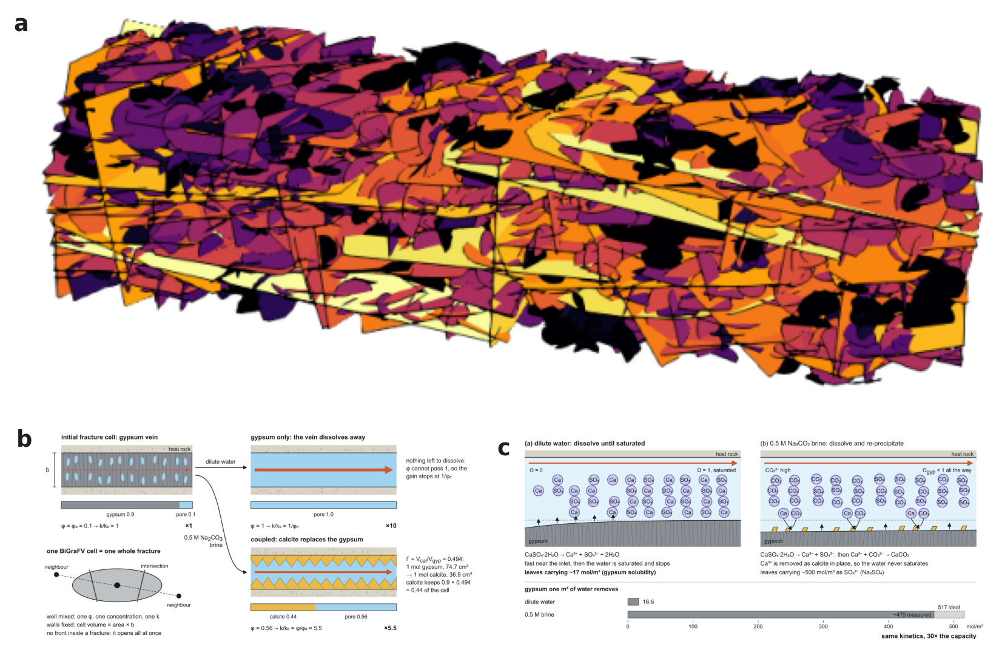
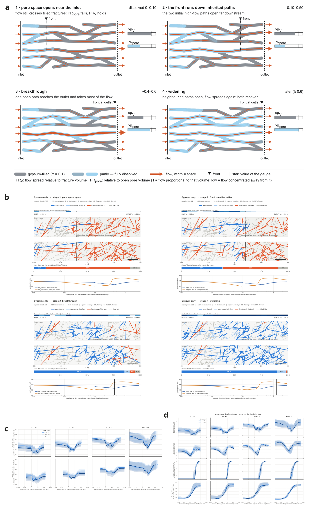
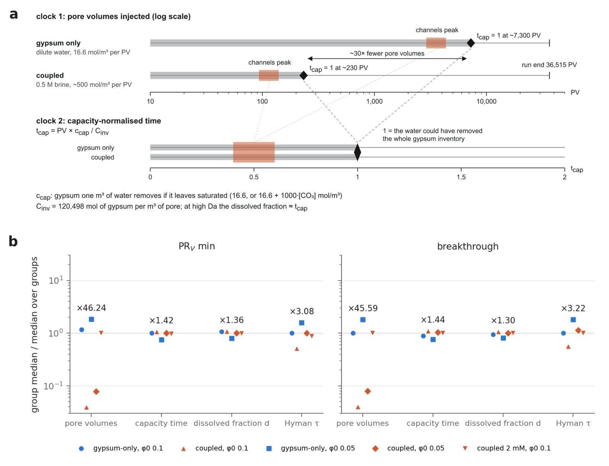
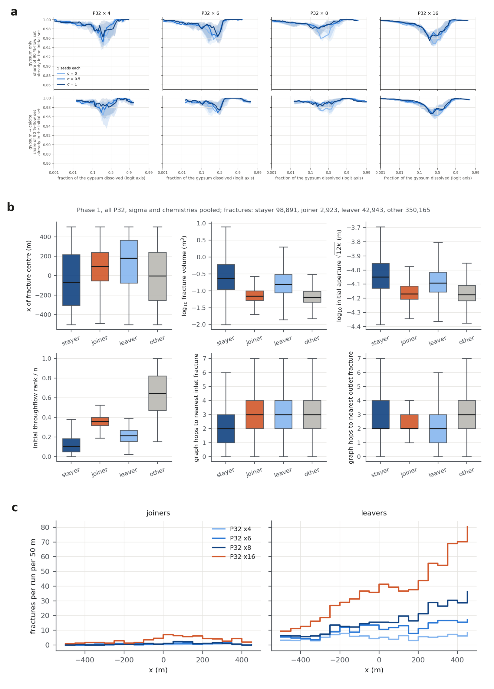
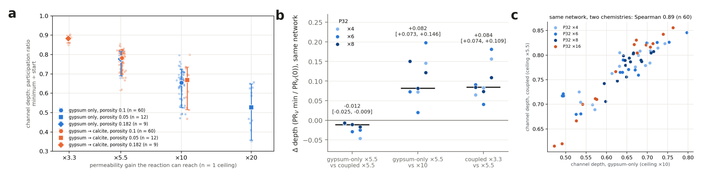
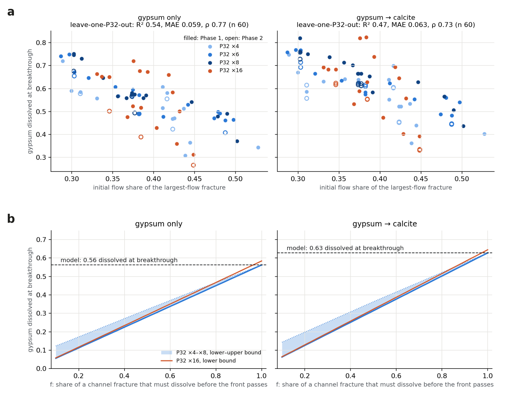
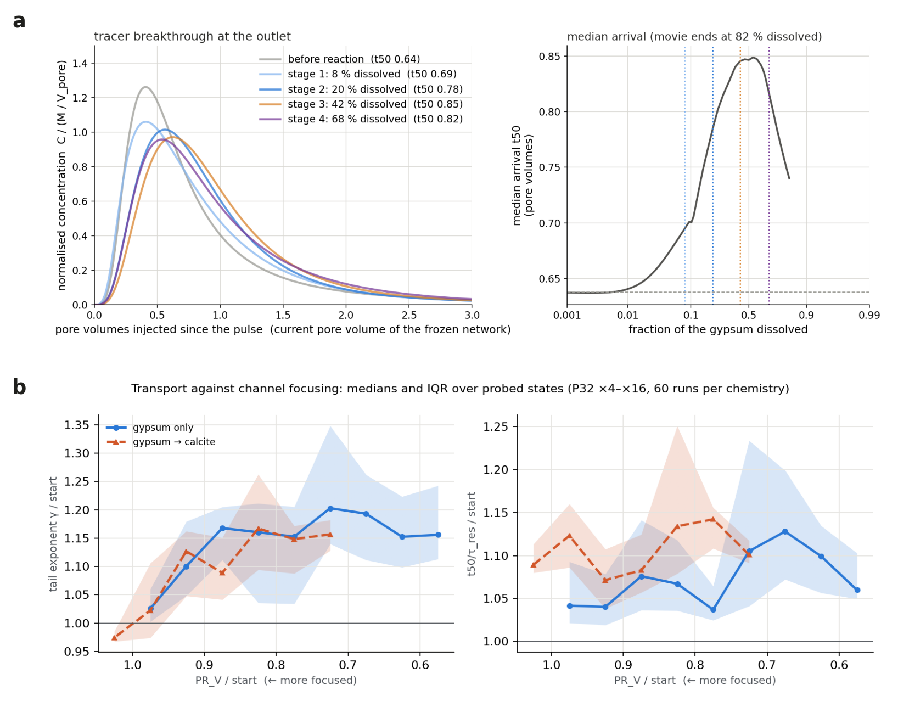
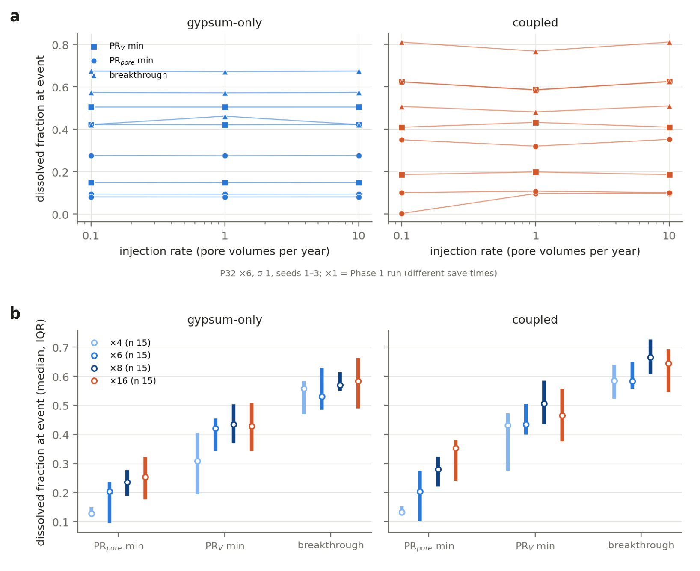

# Draft manuscript figures (5 Nov 2026)

Built by `forsmark_reactive/make_manuscript_figures.py`. Drafts: panels are the study figures assembled with letters; new data panels (3b, 5b, 8a, 8b) are plotted from the CSVs. Supplement candidates: DFN validation (once run), regime map, d_Q size baseline, master curves, early-redistribution depth predictor, olivine outlook.

## Figure 1. Set-up.

(a) Example Forsmark FFM01 network (P32 ×6, σ 1, seed 1, 1 km × 250 m × 250 m), fractures coloured by their share of the injected flow. (b) The one-cell BiGraFV model: one well-mixed control volume per fracture. (c) The two chemistries (gypsum dissolution; gypsum dissolution with calcite precipitation) with their capacity and permeability ceilings.

*Sources:* deck/network_p6_flow.png; report cartoons fracture_cell.svg, chemistry.svg. NOTE: panel a is a 542 x 223 px render; re-render at print resolution (and add a colour bar) before submission.

## Figure 2. Four stages of channel formation.

(a) Cartoon of the four stages on the dissolved-fraction clock. (b) Stage snapshots of the example network (gypsum-only, P32 ×6, σ 1, seed 1): open channel, open space with little flow, flow through filled rock. (c) PR_V against the fraction of gypsum dissolved, all 120 Phase 1 runs (P32 ×4–×16, σ ensembles). (d) PR_V and PR_pore against d (gypsum-only); the PR_pore minimum (pore space and flow decoupled) comes before the PR_V minimum.

*Sources:* four_stages.svg; anim2/stages_gyponly.png (make_stage_movie); channel_pr_vol_diss.png, mechanism_gyponly_diss.png (make_candidate_figures.py). NOTE: panel b still shows a capacity-time strip at the bottom; redraw on d before submission.

## Figure 3. The clock is the mineral consumed.

(a) Capacity time as the predicted clock. (b) Event timing of the five matched groups (σ 1, seeds 1–3, P32 ×4–×16, n = 12 per group, as the report table; Phase 1 gypsum-only and coupled at φ0 0.1, Phase 2 at φ0 0.05 and 2 mM carbonate), each group median divided by the median over groups, on four clocks. Numbers: largest/smallest group median (d ×1.36 and ×1.30, capacity time ×1.42 and ×1.44, τ ×3.1 and ×3.2). On P32 ×4–×8 alone the spread on d is ×1.16–1.20.

*Sources:* capacity_clock.svg; new panel from phase1/stage_events_clocks.csv (fig3b_clock_groups.csv)

## Figure 4. Channels are inherited and narrow.

(a) Share of the 90 %-flow set already in the initial set (overlap0) against d. (b) Stayers, leavers, joiners: size, transmissivity and position. (c) Where along x the leavers and joiners are.

*Sources:* inheritance_diss.png; manuscript/channel_turnover.png, channel_turnover_x.png (channel_turnover.py)

## Figure 5. Depth law.

(a) Channel depth (PR_V minimum / PR_V(0)) against the permeability ceiling, ×3.3–×20 (Phase 1 n = 60 per chemistry, Phase 2 n = 12 per case, Phase 3 n = 9). (b) Ceiling test paired on the same network (P32 ×4–×8, σ 1, seeds 1–3, n = 9): equal ceilings give equal depth across chemistries; lower ceilings give shallower channels. (c) Depth is a network property: same-network depth across chemistries.

*Sources:* depth_law.png (make_candidate_figures.py); new panel from phase1/phase3_ceiling.csv; manuscript/depth_network_property.png

## Figure 6. Breakthrough is predicted by the initial flow field.

(a) Dissolved fraction at breakthrough against the initial flow share of the largest-flow fracture, with leave-one-P32-out cross-validation and Phase 2 (same networks). (b) Wormhole scenario bound: breakthrough if part of each fracture's gypsum stays unreacted.

*Sources:* manuscript/breakthrough_top1.png (breakthrough_predictor.py); wormhole_bound_report.png (wormhole_bound_figure.py)

## Figure 7. Transport signature.

(a) Paused-pulse breakthrough curves before reaction and at the four stages, normalised concentration against pore volumes since the pulse (gypsum-only, P32 ×6, σ 1, seed 1). (b) Tail exponent and t50/τ_res against PR_V across all probed states.

*Sources:* anim3/pulse_btc_only_gyponly.png (make_pulse_movie.py); manuscript/transport_binned.png (transport_channel_link.py)

## Figure 8. Robustness.

(a) Rate test: dissolved fraction at the stage events at 0.1, 1 and 10 pore volumes per year (P32 ×6, σ 1, seeds 1–3; ×1 is the Phase 1 run, saved at different times). (b) Stage events on d by fracture intensity, P32 ×4–×16.

*Sources:* new panels from phase1/phase3_rate.csv and phase1/stage_events_clocks.csv
